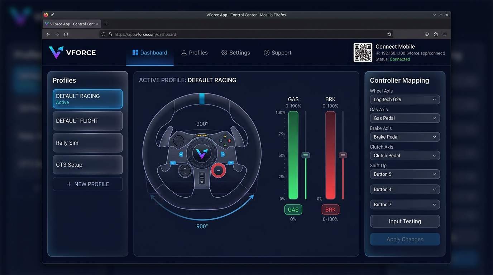
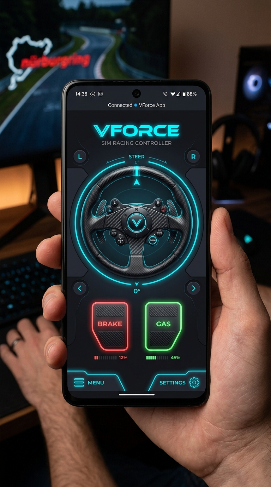

<p align="center">
  
</p>

<h1 align="center">VForce — Virtual Sim Racing Controller</h1>

<p align="center">
  Turn your <strong>smartphone into a steering wheel, pedals, and buttons</strong> — no extra hardware needed.<br/>
  VForce creates a virtual gamepad on your PC and lets you control it from your phone over Wi-Fi.
</p>

<p align="center">
  
  
  
  
</p>

---

## 📸 Screenshots

<table>
  <tr>
    <td align="center"><strong>PC Dashboard</strong></td>
    <td align="center"><strong>Mobile Controller</strong></td>
  </tr>
  <tr>
    <td></td>
    <td></td>
  </tr>
</table>

---

## ✨ Features

- 🎮 **Virtual Gamepad** — Creates a virtual Xbox 360 / gamepad controller on your PC (ViGEmBus on Windows, uinput on Linux)
- 📱 **Phone as Wheel** — Tilt your smartphone to steer using the phone's gyroscope/accelerometer
- 🏎️ **Driving & Flight Modes** — Supports racing (steering + gas/brake) and flight (yoke + rudder + throttle) profiles
- 🧩 **Custom Profiles** — Create, save, and switch between multiple controller layouts
- 📡 **Live Telemetry** — Broadcasts Assetto Corsa telemetry data back to connected clients at 60 Hz
- 🔒 **Auto SSL** — Automatically generates a self-signed certificate for secure HTTPS on your LAN (required for gyroscope access on mobile)
- 🖥️ **Native Desktop App** — Launches as a native window (pywebview) on both Windows and Linux

---

## 🛠️ Requirements

### Common (both platforms)
- Python **3.10 or newer**
- Git

### Windows only
- [ViGEmBus Driver](https://github.com/nefarius/ViGEmBus/releases) — **must be installed first** for the virtual gamepad to work

### Linux only
- `uinput` kernel module (usually pre-installed)
- User must have write access to `/dev/uinput`

---

## 🚀 Getting Started

### 1. Clone the repository

```bash
git clone https://github.com/Agustasvj/SIM_WHEEL1.git
cd SIM_WHEEL1
```

### 2. Create a virtual environment

**Windows:**
```cmd
python -m venv venv
venv\Scripts\activate
```

**Linux:**
```bash
python3 -m venv venv
source venv/bin/activate
```

### 3. Install dependencies

**Windows:**
```cmd
pip install -r requirements_windows.txt
```

**Linux:**
```bash
pip install -r requirements_linux.txt
```

> **Linux extra step** — enable the uinput module:
> ```bash
> sudo modprobe uinput
> sudo usermod -aG input $USER   # then log out and back in
> ```

---

## ▶️ Running (Development Mode)

```bash
# Windows
venv\Scripts\python.exe main.py

# Linux
source venv/bin/activate
python main.py
```

The app will start and print the connection info:

```
============================================================
Server started successfully!
PC Dashboard :  http://localhost:8000/
Phone (Mobile): https://192.168.x.x:8443/mobile
  NOTE: Accept the certificate warning in your phone browser once.
============================================================
```

A native window will also open with the PC dashboard automatically.

---

## 📦 Building a Standalone Executable

### Windows

1. Make sure your `venv` is set up and dependencies installed
2. Run the build script:

```cmd
build.bat
```

The compiled `.exe` will be in `dist/VForce.exe`.

### Linux

```bash
chmod +x build.sh
./build.sh
```

The compiled binary will be in `dist/VForce`.

> **Note:** The build scripts use PyInstaller with the provided `.spec` files (`SIM_WHEEL.spec` for Windows, `SIM_WHEEL_linux.spec` for Linux).

---

## 📱 Connecting Your Phone

1. Make sure your **PC and phone are on the same Wi-Fi network**
2. Launch VForce on your PC
3. On your phone, open a browser and navigate to the URL shown in the PC dashboard:
   ```
   https://192.168.x.x:8443/mobile
   ```
4. Your browser will warn about the self-signed certificate — tap **"Advanced"** → **"Proceed"** (this is safe, it's your own local server)
5. The mobile controller UI will load — tilt your phone to steer!

---

## 🎮 How to Use

### PC Dashboard (`http://localhost:8000`)

| Section | Description |
|---|---|
| **Profiles** | Create and switch between controller layouts |
| **Canvas** | Drag and resize elements (wheel, pedals, buttons) |
| **Mappings** | Assign each element to a gamepad output (LEFT_STICK_X, RIGHT_TRIGGER, etc.) |
| **Mode** | Switch between `Driving` and `Flight` mode |

### Mobile Controller

| Gesture | Action |
|---|---|
| **Tilt phone left/right** | Steering input |
| **Tap GAS button** | Right trigger / throttle |
| **Tap BRAKE button** | Left trigger / brake |

---

## 🗂️ Project Structure

```
SIM_WHEEL/
├── main.py                  # FastAPI server + webview launcher
├── controller.py            # Virtual gamepad (ViGEmBus / uinput)
├── telemetry.py             # Assetto Corsa telemetry reader
├── process_assets.py        # Asset processing utilities
├── profiles.json            # Saved controller profiles
├── static/                  # Web UI (HTML, CSS, JS)
│   ├── index.html           # PC dashboard
│   ├── mobile.html          # Mobile controller
│   ├── pc.html              # PC driving/flight view
│   └── ...
├── packages/                # User assets (steering wheels, pedal plates, backgrounds)
│   ├── Steering/
│   ├── Pedals/
│   └── Background/
├── requirements.txt         # Base dependencies
├── requirements_windows.txt # Windows-specific deps
├── requirements_linux.txt   # Linux-specific deps
├── build.bat                # Windows build script
├── build.sh                 # Linux build script
├── SIM_WHEEL.spec           # PyInstaller spec (Windows)
└── SIM_WHEEL_linux.spec     # PyInstaller spec (Linux)
```

---

## 🔧 Troubleshooting

### Virtual gamepad not working on Linux
```bash
# Load the uinput module
sudo modprobe uinput

# Give your user access (persistent)
sudo usermod -aG input $USER
# Log out and back in, then try again

# One-time quick fix (no re-login needed)
sudo chmod 660 /dev/uinput && sudo chown root:input /dev/uinput
```

### Virtual gamepad not working on Windows
- Make sure [ViGEmBus](https://github.com/nefarius/ViGEmBus/releases) is installed
- Try running VForce as Administrator

### Phone can't connect
- Confirm PC and phone are on the **same Wi-Fi network**
- Check your firewall — port `8443` must be allowed
- Accept the SSL certificate warning in your browser

### "VForce is already running" error
- VForce is already running in the background
- Open `http://localhost:8000` and use the shutdown button, or kill the process via Task Manager / `pkill VForce`

---

## 📄 License

MIT License — free to use, modify, and distribute.

---

<p align="center">Made with ❤️ for sim racers everywhere</p>
